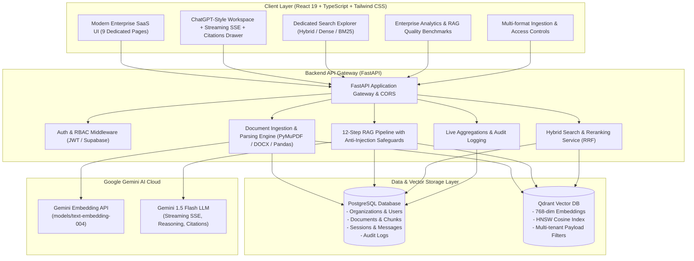

# Enterprise AI Knowledge Assistant

[](https://fastapi.tiangolo.com)
[](https://reactjs.org/)
[](https://tailwindcss.com/)
[](https://ai.google.dev/)
[](https://qdrant.tech/)
[](https://www.postgresql.org/)
[](https://www.docker.com/)

An intelligent enterprise knowledge management and retrieval platform where organizations securely ingest internal documents (PDF, DOCX, TXT, CSV, XLSX) and employees interact with company knowledge via natural language. Powered by an advanced 12-step RAG pipeline, dense + sparse hybrid search with Reciprocal Rank Fusion (RRF), strict multi-tenant isolation, role-based document access controls (RBAC), and verified citations pointing directly to source documents and page numbers.

---

## 1. System Architecture



---

## 2. Advanced 12-Step RAG Pipeline

1. **Document Ingestion**: Multi-file drag-and-drop parsing supporting `.pdf` (PyMuPDF), `.docx` (python-docx), `.txt`, `.csv` (pandas), and `.xlsx` (openpyxl).
2. **Document Cleaning**: Normalizes irregular whitespaces, collapses excess newlines, and preserves markdown tabular structures.
3. **Intelligent Chunking**: Recursive character splitting with configurable chunk size (800 chars) and overlap (150 chars). Preserves page numbers, headings, and document titles in every chunk.
4. **Embedding Generation**: Produces 768-dimensional normalized unit vectors via Google Gemini (`models/text-embedding-004`).
5. **Vector Storage**: Persists embeddings into Qdrant with payload indexing on `organization_id`, `document_id`, `access_level`, `allowed_roles`, and `category`.
6. **Query Understanding & Contextual Rewriting**: Rewrites conversational and ambiguous queries into standalone search queries using Gemini.
7. **Hybrid Retrieval**: Combines Dense Vector Cosine Similarity with Sparse BM25 Keyword Search (`rank-bm25`).
8. **Reciprocal Rank Fusion (RRF) Reranking**: Merges dense and sparse candidates via $RRF(d) = \sum \frac{1}{60 + \text{rank}(d)}$.
9. **Context Construction & Anti-Prompt-Injection Safeguards**: Encapsulates retrieved chunks within unprivileged delimiter boundaries (`<<<UNTRUSTED_DOCUMENT_START>>>`) to prevent prompt injections.
10. **Grounded Answer Generation**: Streams answers token-by-token via Server-Sent Events (SSE).
11. **Citation Generation**: Formats clickable citation cards pointing to exact document titles, page numbers, and excerpts.
12. **Response & Faithfulness Verification Gate**: Cross-checks factual claims against retrieved evidence. Transparently informs users if evidence is insufficient instead of hallucinating.

---

## 3. Multi-Tenant Enterprise Security & RBAC

| Role | Permissions |
|------|-------------|
| **Admin** | Full system access: manage users, change roles, view audit logs, ingest/delete documents, and query all documents in the organization. |
| **Manager** | Ingest and delete team documents, inspect knowledge bases, manage employee accounts, and view analytics. |
| **Employee** | Query, chat, and search authorized documents (`PUBLIC`, role-matched, or self-uploaded). |

- **Zero-Leakage Multi-Tenancy**: Every vector and SQL query enforces `organization_id` matching at the database index level.
- **Document-Level Access Levels**:
  - `PUBLIC`: Accessible by all employees within the organization.
  - `ROLE_RESTRICTED`: Accessible only by users whose role is in `allowed_roles`.
  - `PRIVATE`: Accessible exclusively by the uploader and Organization Admins.

---

## 4. UI Pages Overview

1. **Login & Registration**: Secure authentication with pre-configured 1-click demo logins for Admin, Manager, and Employee.
2. **Main Dashboard**: Executive overview with real database stats, processing success rates, average latencies, and recent documents.
3. **AI Chat Workspace**: ChatGPT-style multi-session workspace with real-time SSE streaming, clickable citation drawers, suggested prompts, and thumbs up/down feedback.
4. **Document Management**: Multi-format file ingestion, drag-and-drop, category & tag assignment, status badges, chunk preview modal, and permission editor.
5. **Knowledge Base Explorer**: Qdrant vector collection inspector and chunk payload viewer.
6. **Search Explorer**: Dedicated hybrid search page with mode toggle (Hybrid, Vector, BM25 Keyword), category filters, and score indicators.
7. **Enterprise Analytics**: Real SQL aggregations for query volume, latencies, document distribution, and an automated RAG evaluation trigger.
8. **Users & Roles**: Member directory, user invitations, role switcher, and compliance audit trail viewer.
9. **Settings & Profile**: Organization configuration, Gemini API integration status badge, and appearance (light/dark mode).

---

## 5. Technology Stack

- **Frontend**: React 19, TypeScript, Tailwind CSS, Lucide Icons, Vite.
- **Backend**: Python 3.11+, FastAPI, SQLAlchemy 2.0 (async), Pydantic v2.
- **Vector DB**: Qdrant (remote server or local embedded disk/memory).
- **Relational DB**: PostgreSQL (with asyncpg / aiosqlite fallback).
- **Document Extractors**: PyMuPDF (`fitz`), `python-docx`, `pandas`, `openpyxl`.
- **RAG & Search**: BM25Okapi (`rank-bm25`), Reciprocal Rank Fusion (RRF).
- **LLM & Embeddings**: Google Gemini API (`gemini-1.5-flash`, `models/text-embedding-004`).
- **DevOps**: Docker, Docker Compose, Nginx, Render, Vercel.

---

## 6. Getting Started (Local Development)

### Prerequisites
- Python 3.11+
- Node.js 20+ & npm

### Backend Setup

```bash
cd backend

# Install dependencies
pip install -r requirements.txt

# Configure environment variables (optional, defaults work out of the box)
cp .env.example .env

# Optional: Add your Gemini API key in .env
# GEMINI_API_KEY="your-google-gemini-key"

# Run FastAPI backend server
uvicorn app.main:app --reload --host 0.0.0.0 --port 8000
```

The backend automatically creates tables, seeds the default organization (`Acme Enterprise`), and creates default demo users:
- **Admin**: `admin@enterprise.ai` / `Admin@123456`
- **Manager**: `manager@enterprise.ai` / `Manager@123456`
- **Employee**: `employee@enterprise.ai` / `Employee@123456`

Swagger OpenAPI docs are accessible at: `http://localhost:8000/docs`

### Frontend Setup

```bash
cd frontend

# Install dependencies
npm install

# Start Vite development server
npm run dev
```

Open `http://localhost:5173` in your browser.

---

## 7. Docker Compose Deployment

To run the complete stack (PostgreSQL, Qdrant, Backend, and Frontend) in Docker:

```bash
# 1. Provide your Gemini API key in .env
echo "GEMINI_API_KEY=your_gemini_api_key_here" > .env

# 2. Build and launch all services
docker-compose up --build -d
```

- **Frontend UI**: `http://localhost:3000`
- **Backend API**: `http://localhost:8000`
- **Qdrant Dashboard**: `http://localhost:6333/dashboard`

---

## 8. Running Automated Tests

Run the full pytest suite (Unit tests, RBAC tests, Vector Isolation tests, and End-to-End RAG Ingestion):

```bash
cd backend
python -m pytest -v
```

### Automated RAG Evaluation Benchmark

Run the RAG benchmark measuring Recall@K, Mean Reciprocal Rank (MRR), Faithfulness, and Answer Relevance:

```bash
cd backend
python -m pytest tests/test_rag_eval.py -v
```

Or trigger it directly from the UI on the **Enterprise Analytics** page!

---

## 9. Cloud Deployment Guide

### Backend on Render
1. Push this repository to GitHub.
2. In [Render Dashboard](https://dashboard.render.com), click **New** -> **Blueprint**.
3. Select your repository. Render automatically reads `render.yaml` to provision the PostgreSQL database and FastAPI service.
4. Add `GEMINI_API_KEY` under Environment Variables.

### Frontend on Vercel
1. In [Vercel Dashboard](https://vercel.com), click **Add New** -> **Project**.
2. Select your repository and select root directory `frontend/`.
3. Vercel automatically detects Vite. Deploy using the provided `vercel.json` rewrite configuration.
